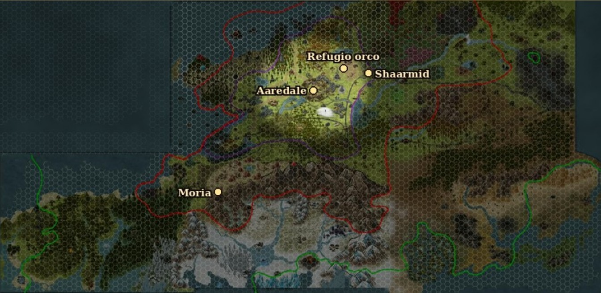

  

    
    
  

  

    
    <h1>La Lanza de Plata</h1>
    
El Faro de Aaredale lleva tres meses apagado. El Cuerpo de Aventureros sigue saliendo a la oscuridad.

    

      <a class="md-button md-button--primary" href="empezar/">Empezar a jugar</a>
      <a class="md-button" href="mundo/">Antes de leer la Gaceta</a>
    

  

Este es el repositorio de la mesa **La Lanza de Plata**, una campaña *west marches* de D&D 5e en la meseta de Shaar, al sur de Faerûn. Si algo de aquí no coincide con lo que leíste en otro lado, manda lo que dice este sitio.

<nav class="tablon" aria-label="Secciones">
  <a href="empezar/"><b>Empezar a jugar</b><small>Crea tu personaje, regístralo y pide cupo en una mesa.</small></a>
  <a href="empezar/horarios/"><b>Horarios</b><small>Miércoles y sábados. Qué mesa es de qué tier.</small></a>
  <a href="reglas/"><b>Reglas de la mesa</b><small>Parties de máximo 5, 3 niveles de diferencia como máximo.</small></a>
  <a href="mundo/los-13/"><b>Los 13 de Aaredale</b><small>Quién gobierna la ciudad y a quién acudir.</small></a>
  <a href="mundo/mapa/"><b>El mapa</b><small>Hexes de 25 millas y hasta dónde llega cada tier.</small></a>
  <a href="documentos/"><b>Manuales</b><small>Manual básico, avanzado, tesoro, recompensas y más.</small></a>
</nav>
