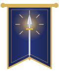
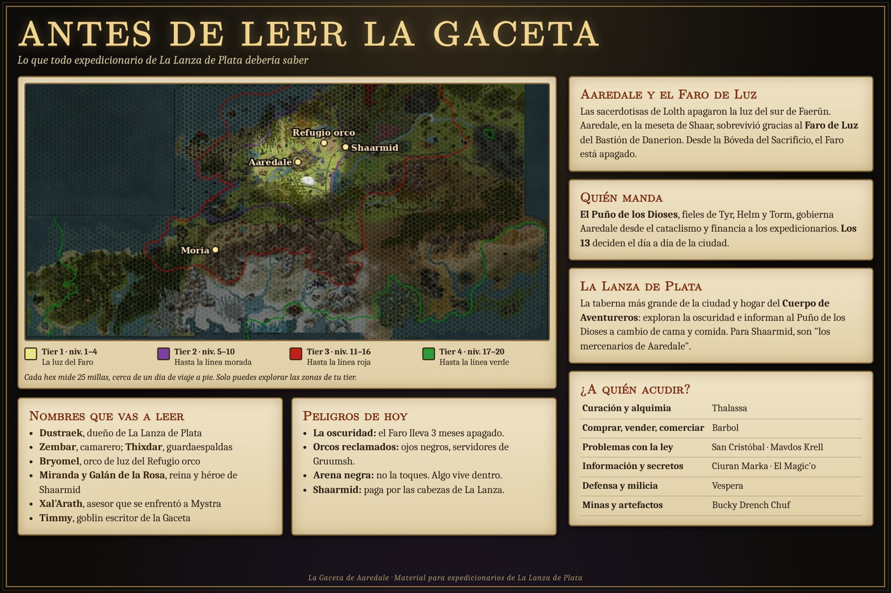

  

    
    
  

  

    
    <h1>La Lanza de Plata</h1>
    
El Faro de Aaredale lleva tres meses apagado. El Cuerpo de Aventureros sigue saliendo a la oscuridad.

    

      <a class="md-button md-button--primary" href="empezar/">Empezar a jugar</a>
      <a class="md-button" href="mundo/">Antes de leer la Gaceta</a>
    

  

Este es el repositorio de la mesa **La Lanza de Plata**, una campaña *west marches* de D&D 5e en la meseta de Shaar, al sur de Faerûn. Si algo de aquí no coincide con lo que leíste en otro lado, manda lo que dice este sitio.
{ .portada-intro }

<h2 class="portada-titulo">¿Primera vez en la Lanza?</h2>

Cuatro pasos y estás listo para tu primera expedición.

<nav class="ruta" aria-label="Primeros pasos">
  <a href="reglas/"><b>Lee las reglas de la mesa</b><small>Son cortas: parties, tiers y cómo se arman las mesas.</small></a>
  <a href="documentos/manual-basico/"><b>Crea tu personaje</b><small>Libros permitidos, especie, trasfondo y equipo inicial.</small></a>
  <a href="empezar/personaje/"><b>Regístralo con el DM</b><small>Tu hoja de registro y tu ficha en la galería.</small></a>
  <a href="empezar/horarios/"><b>Pide cupo en una mesa</b><small>Miércoles y sábados, según tu tier.</small></a>
</nav>

<h2 class="portada-titulo">A la mano en la mesa</h2>

Lo que más se consulta durante y entre sesiones.

<nav class="herramientas" aria-label="Consulta rápida">
  <a href="documentos/mercado/"><svg viewBox="0 0 24 24" aria-hidden="true"><path d="M5 4h14l1.5 5a3 3 0 0 1-5.5 1.6A3 3 0 0 1 12 12a3 3 0 0 1-3-1.4A3 3 0 0 1 3.5 9zm1 9.3V20h12v-6.7a4.9 4.9 0 0 0 2 .1V22H4v-8.6a4.9 4.9 0 0 0 2-.1M9 15h6v5H9z"/></svg><b>Mercado</b><small>Precios de Aaredale y servicios</small></a>
  <a href="documentos/tesoro/"><svg viewBox="0 0 24 24" aria-hidden="true"><path d="M4 9a4 4 0 0 1 4-4h8a4 4 0 0 1 4 4v1H4zm0 3h7v2h2v-2h7v8H4zm7-1h2v4h-2z"/></svg><b>Tesoro</b><small>Tablas para gastar tus PT</small></a>
  <a href="personajes/"><svg viewBox="0 0 24 24" aria-hidden="true"><path d="M12 2a4.5 4.5 0 1 1 0 9 4.5 4.5 0 0 1 0-9m0 11c4.4 0 8 2.2 8 5v3H4v-3c0-2.8 3.6-5 8-5"/></svg><b>Personajes</b><small>Fichas interactivas</small></a>
  <a href="mundo/tablon/"><svg viewBox="0 0 24 24" aria-hidden="true"><path d="M3 4h18v12H3zm2 2v8h14V6zm2 1h6v2H7zm0 3h10v2H7zM8 17h2l-1 4H7zm6 0h2l1 4h-2z"/></svg><b>Tablón</b><small>Trabajos abiertos</small></a>
  <a href="mundo/mapa/"><svg viewBox="0 0 24 24" aria-hidden="true"><path d="m15 5.1-6-2-6 2.3V21l6-2.3 6 2 6-2.3V3zM10 5l4 1.3v12.7l-4-1.3z"/></svg><b>Mapa</b><small>Hexes y tiers</small></a>
  <a href="solicitudes/"><svg viewBox="0 0 24 24" aria-hidden="true"><path d="M6 2h9l5 5v15H6zm8 1.5V8h4.5zM9 12v2h8v-2zm0 4v2h5v-2z"/></svg><b>Solicitudes</b><small>Pídele algo al DM</small></a>
</nav>

<a class="gaceta-aviso" href="gaceta/edicion-especial/">
  
  <small>Última Gaceta de Aaredale</small><b>Edición especial: todo lo que pasó</b>El Apagón, la guerra de Shaarmid, la Bóveda del Sacrificio y tres meses a oscuras, contado por Timmy.
</a>

<h2 class="portada-titulo">El mundo</h2>

<nav class="tablon" aria-label="Secciones">
  <a href="mundo/"><b>Antes de leer la Gaceta</b><small>Lo que todo expedicionario debería saber.</small></a>
  <a href="mundo/aaredale/"><b>Aaredale</b><small>La ciudad, el Faro y el Bastión de Danerion.</small></a>
  <a href="mundo/los-13/"><b>Los 13 de Aaredale</b><small>Quién gobierna la ciudad y a quién acudir.</small></a>
  <a href="mundo/cronicas/"><b>Crónicas</b><small>Lo que ha pasado hasta hoy.</small></a>
  <a href="documentos/"><b>Manuales</b><small>Manual básico, avanzado, recompensas y más.</small></a>
  <a href="faq/"><b>Preguntas frecuentes</b><small>Las dudas de siempre, resueltas.</small></a>
</nav>
