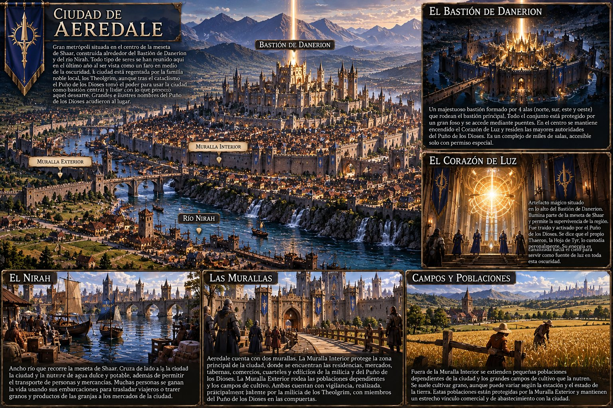

# Aaredale

{ .ilustracion loading=lazy }

Gran metrópoli en el centro de la meseta de Shaar, construida alrededor del **Bastión de Danerion** y del **río Nirah**. Todo tipo de seres se han reunido aquí en el último año, al verla como un faro en medio de la oscuridad.

La ciudad la regenta la familia noble local, los **Theolgrim**. Pero tras el cataclismo, **el Puño de los Dioses** tomó el poder para usar la ciudad como bastión central y liderar desde allí la lucha contra el desastre. Grandes e ilustres nombres del Puño de los Dioses acudieron al lugar.

## El Bastión de Danerion

Un majestuoso bastión de cuatro alas (norte, sur, este y oeste) que rodean el bastión principal. Todo el conjunto está protegido por un gran foso, y se entra por puentes.

En el centro se mantiene encendido el **Corazón de Luz**, y allí residen las mayores autoridades del Puño de los Dioses. Es un complejo de miles de salas, accesible solo con permiso especial. En su primer piso gobiernan [Los 13](los-13.md).

## El Corazón de Luz

Artefacto mágico situado en lo alto del Bastión de Danerion. Ilumina parte de la meseta de Shaar y permite la supervivencia de la región.

Lo trajo y lo activó el Puño de los Dioses. Se dice que el propio **Thaeron, la Hoja de Tyr**, lo custodia personalmente. Su energía se canaliza hacia el cielo para servir como fuente de luz en toda esta oscuridad.

!!! warning "Hoy"
    Desde la Bóveda del Sacrificio, el Faro está apagado. Lleva 3 meses así.

## El Nirah

Ancho río que recorre la meseta de Shaar. Cruza la ciudad de lado a lado y la nutre de agua dulce y potable, además de permitir el transporte de personas y mercancías. Mucha gente se gana la vida con sus embarcaciones, trasladando viajeros o llevando granos y productos de las granjas a los mercados de la ciudad.

## Las murallas

Aaredale tiene dos murallas:

- **La Muralla Interior** protege la zona principal de la ciudad: residencias, mercados, tabernas, comercios, cuarteles y edificios de la milicia y del Puño de los Dioses.
- **La Muralla Exterior** rodea las poblaciones dependientes y los campos de cultivo.

Las dos están vigiladas, sobre todo por la milicia de los Theolgrim, con miembros del Puño de los Dioses en las compuertas.

## Campos y poblaciones

Fuera de la Muralla Interior se extienden pequeñas poblaciones dependientes de la ciudad y los grandes campos de cultivo que la alimentan. Se suele cultivar grano, aunque puede variar según la estación y el estado de la tierra. Estas poblaciones están protegidas por la Muralla Exterior y mantienen un estrecho vínculo comercial y de abastecimiento con la ciudad.
