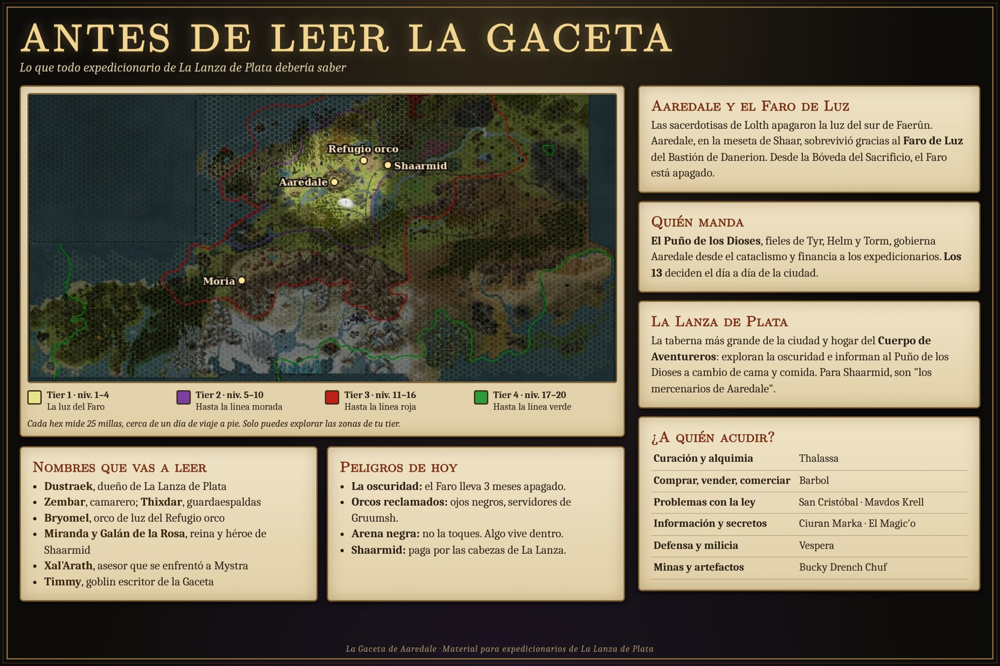

# Antes de leer la Gaceta

Lo que todo expedicionario de La Lanza de Plata debería saber. Esto es conocimiento común en Aaredale; lo que tu personaje descubra más allá lo aprende jugando.

{ .ilustracion loading=lazy }

## Aaredale y el Faro de Luz

Las sacerdotisas de Lolth apagaron la luz del sur de Faerûn. **Aaredale**, en la meseta de Shaar, sobrevivió gracias al **Faro de Luz** del Bastión de Danerion. Desde la **Bóveda del Sacrificio**, el Faro está apagado.

Más en [Aaredale](aaredale.md).

## Quién manda

**El Puño de los Dioses**, fieles de Tyr, Helm y Torm, gobierna Aaredale desde el cataclismo y financia a los expedicionarios. **[Los 13](los-13.md)** deciden el día a día de la ciudad.

## La Lanza de Plata

La taberna más grande de la ciudad y hogar del **Cuerpo de Aventureros**: exploran la oscuridad e informan al Puño de los Dioses a cambio de cama y comida. Para Shaarmid, son "los mercenarios de Aaredale".

Más en [La taberna y el Cuerpo de Aventureros](la-lanza.md).

## Nombres que vas a leer

| Nombre | Quién es |
|---|---|
| **Dustraek** | Dueño de La Lanza de Plata |
| **Zembar** | Camarero de la taberna |
| **Thixdar** | Guardaespaldas de la taberna |
| **Bryomel** | Orco de luz del Refugio orco |
| **Miranda y Galán de la Rosa** | Reina y héroe de Shaarmid |
| **Xal'Arath** | Asesor que se enfrentó a Mystra |
| **Timmy** | Goblin escritor de la Gaceta |

## Peligros de hoy

!!! danger "La oscuridad"
    El Faro lleva **3 meses apagado**.

!!! danger "Orcos reclamados"
    Ojos negros, servidores de Gruumsh.

!!! danger "Arena negra"
    No la toques. Algo vive dentro.

!!! danger "Shaarmid"
    Paga por las cabezas de La Lanza.

## Secciones

- [Aaredale](aaredale.md): la ciudad, el Bastión de Danerion y el Corazón de Luz.
- [La taberna y el Cuerpo de Aventureros](la-lanza.md): tu casa en la ciudad.
- [Los 13 de Aaredale](los-13.md): quién decide qué, y a quién acudir.
- [El mapa](mapa.md): hexes, distancias y zonas por tier.
- [Crónicas](cronicas.md): lo que ya hicieron los aventureros.
