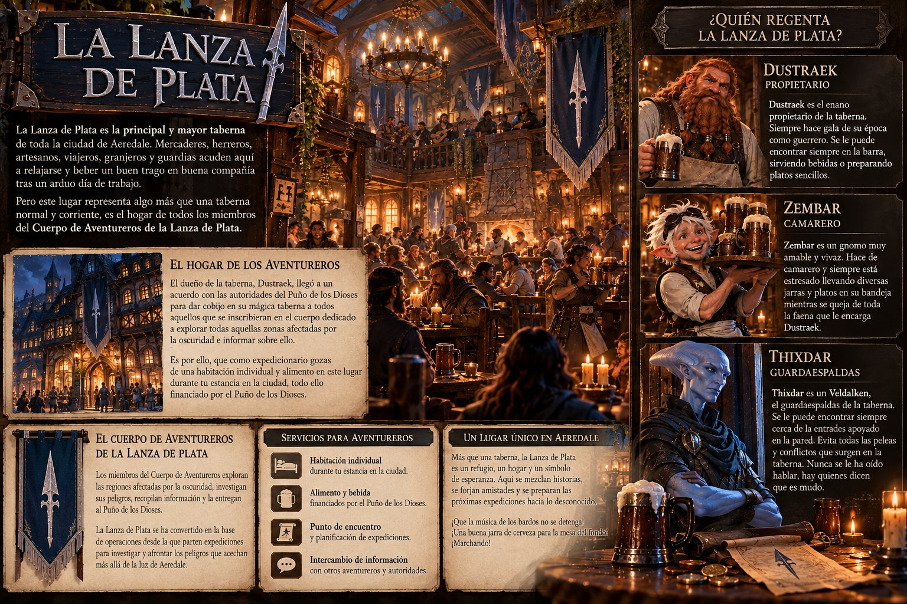

# La taberna y el Cuerpo de Aventureros

{ .ilustracion loading=lazy }

**La Lanza de Plata** es la principal y mayor taberna de Aaredale. Mercaderes, herreros, artesanos, viajeros, granjeros y guardias vienen aquí a relajarse y a beber en buena compañía tras un arduo día de trabajo.

Pero es algo más que una taberna: es el hogar de todos los miembros del **Cuerpo de Aventureros de la Lanza de Plata**.

## El hogar de los aventureros

Dustraek, el dueño, llegó a un acuerdo con las autoridades del Puño de los Dioses para dar cobijo en su taberna a todos los que se inscriban en el cuerpo dedicado a explorar las zonas afectadas por la oscuridad e informar sobre ellas.

Por eso, como expedicionario, tienes habitación individual y comida en la taberna durante tu estancia en la ciudad, todo financiado por el Puño de los Dioses.

## El Cuerpo de Aventureros

Los miembros del Cuerpo exploran las regiones afectadas por la oscuridad, investigan sus peligros, recopilan información y la entregan al Puño de los Dioses.

La taberna es la base de operaciones desde la que salen las expediciones para investigar y enfrentar los peligros que acechan más allá de la luz de Aaredale.

## Servicios para aventureros

| Servicio | Qué incluye |
|---|---|
| Habitación individual | Durante tu estancia en la ciudad |
| Alimento y bebida | Financiados por el Puño de los Dioses |
| Punto de encuentro | Planificación de expediciones |
| Intercambio de información | Con otros aventureros y autoridades |

## Quién regenta la Lanza de Plata

### Dustraek, propietario

El enano dueño de la taberna. Siempre presume de su época como guerrero. Se le puede encontrar siempre en la barra, sirviendo bebidas o preparando platos sencillos.

### Zembar, camarero

Un gnomo muy amable y vivaz. Siempre está estresado llevando jarras y platos en su bandeja, mientras se queja de toda la faena que le encarga Dustraek.

### Thixdar, guardaespaldas

Un veldalken, el guardaespaldas de la taberna. Se le encuentra siempre cerca de la entrada, apoyado en la pared. Evita todas las peleas y conflictos de la taberna. Nunca se le ha oído hablar; hay quienes dicen que es mudo.

---

*Más que una taberna, la Lanza de Plata es un refugio, un hogar y un símbolo de esperanza. Aquí se mezclan historias, se forjan amistades y se preparan las próximas expediciones hacia lo desconocido.*
