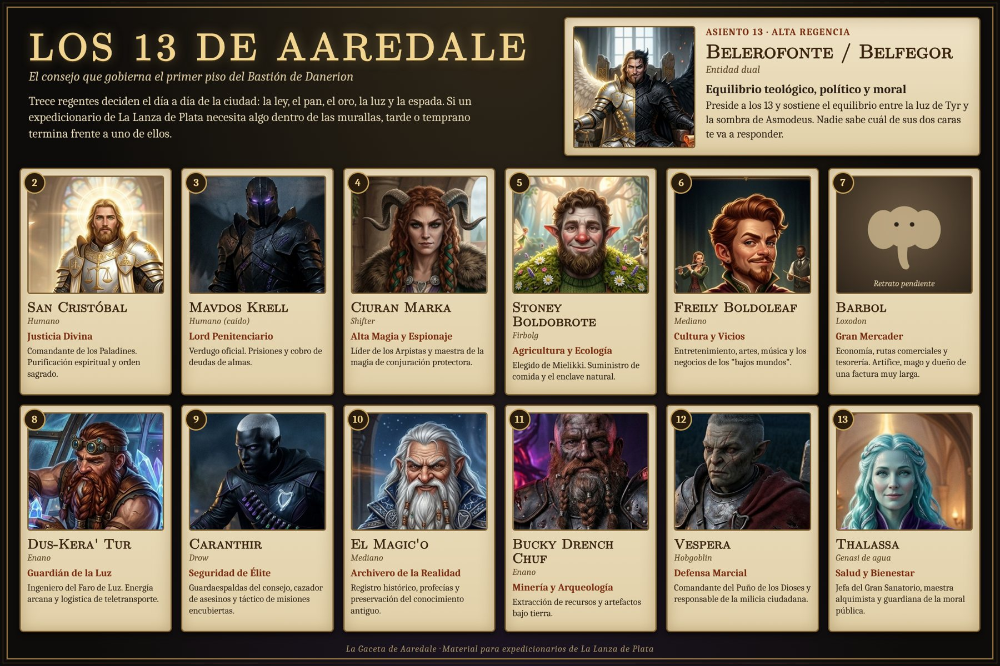

# Los 13 de Aaredale

El consejo que gobierna el primer piso del Bastión de Danerion. Trece regentes deciden el día a día de la ciudad: la ley, el pan, el oro, la luz y la espada. Si un expedicionario de La Lanza de Plata necesita algo dentro de las murallas, tarde o temprano termina frente a uno de ellos.

{ .ilustracion loading=lazy }

## ¿A quién acudir?

| Necesitas… | Ve con |
|---|---|
| Curación y alquimia | Thalassa |
| Comprar, vender, comerciar | Barbol |
| Problemas con la ley | San Cristóbal, Mavdos Krell |
| Información y secretos | Ciuran Marka, El Magic'o |
| Defensa y milicia | Vespera |
| Minas y artefactos | Bucky Drench Chuf |

## Los regentes

  
13<b>Belerofonte / Belfegor</b><i>Entidad dual</i><em>Alta Regencia</em>
Preside a los 13 y sostiene el equilibrio entre la luz de Tyr y la sombra de Asmodeus. Nadie sabe cuál de sus dos caras te va a responder.

  
2<b>San Cristóbal</b><i>Humano</i><em>Justicia Divina</em>
Comandante de los Paladines. Purificación espiritual y orden sagrado.

  
3<b>Mavdos Krell</b><i>Humano (caído)</i><em>Lord Penitenciario</em>
Verdugo oficial. Prisiones y cobro de deudas de almas.

  
4<b>Ciuran Marka</b><i>Shifter</i><em>Alta Magia y Espionaje</em>
Líder de los Arpistas y maestra de la magia de conjuración protectora.

  
5<b>Stoney Boldobrote</b><i>Firbolg</i><em>Agricultura y Ecología</em>
Elegido de Mielikki. Suministro de comida y el enclave natural.

  
6<b>Freily Boldoleaf</b><i>Mediano</i><em>Cultura y Vicios</em>
Entretenimiento, artes, música y los negocios de los «bajos mundos».

  
7<b>Barbol</b><i>Loxodon</i><em>Gran Mercader</em>
Economía, rutas comerciales y tesorería. Artífice, mago y dueño de una factura muy larga.

  
8<b>Dus-Kera' Tur</b><i>Enano</i><em>Guardián de la Luz</em>
Ingeniero del Faro de Luz. Energía arcana y logística de teletransporte.

  
9<b>Caranthir</b><i>Drow</i><em>Seguridad de Élite</em>
Guardaespaldas del consejo, cazador de asesinos y táctico de misiones encubiertas.

  
10<b>El Magic'o</b><i>Mediano</i><em>Archivero de la Realidad</em>
Registro histórico, profecías y preservación del conocimiento antiguo.

  
11<b>Bucky Drench Chuf</b><i>Enano</i><em>Minería y Arqueología</em>
Extracción de recursos y artefactos bajo tierra.

  
12<b>Vespera</b><i>Hobgoblin</i><em>Defensa Marcial</em>
Comandante del Puño de los Dioses y responsable de la milicia ciudadana.

  
13<b>Thalassa</b><i>Genasi de agua</i><em>Salud y Bienestar</em>
Jefa del Gran Sanatorio, maestra alquimista y guardiana de la moral pública.

!!! pendiente "Revisar (DM)"
    En la ilustración, Belerofonte / Belfegor y Thalassa aparecen los dos con el asiento 13, y no hay asiento 1. Confirma cuál es el número de cada uno.
