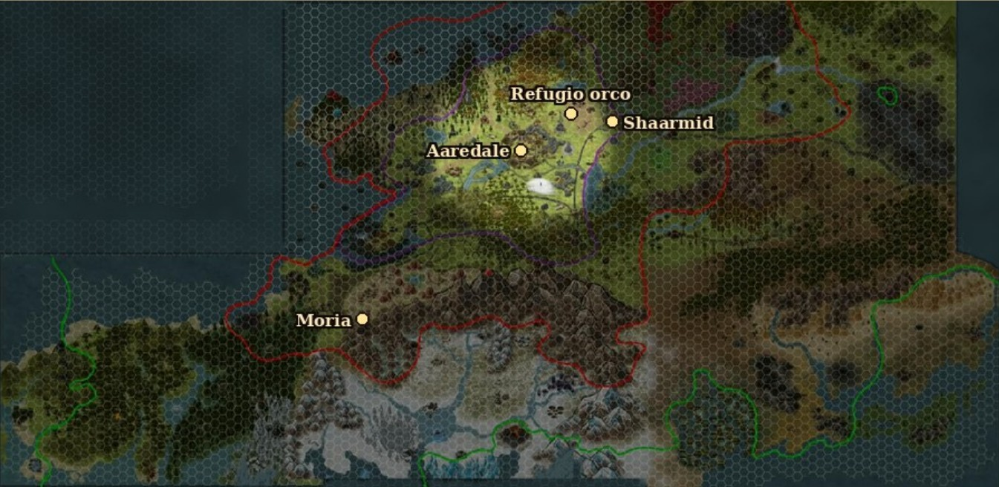

# El mapa

{ .ilustracion }

[Ver el mapa en tamaño completo](../assets/img/mapa.jpg){ target=_blank }

Cada hex mide **25 millas**, cerca de un día de viaje a pie. **Solo puedes explorar las zonas de tu tier.** 

| Zona | Tier | Niveles | Hasta dónde llega |
|---|---|---|---|
| Amarilla | T1 | 1 – 4 | La luz del Faro |
| Morada | T2 | 5 – 10 | Hasta la línea morada |
| Roja | T3 | 11 – 16 | Hasta la línea roja |
| Verde | T4 | 17 – 20 | Hasta la línea verde |

## Lugares conocidos

- **Aaredale:** la ciudad capital, en el centro de la meseta de Shaar. Lee [Aaredale](aaredale.md).
- **Refugio orco:** hogar de Bryomel, el orco de luz.
- **Shaarmid:** ciudad de altos elfos, en guerra con los aventureros de la Lanza. Lee las [Crónicas](cronicas.md).
- **Moria:** al suroeste, más allá de la línea morada.

!!! pendiente "Por completar (DM)"
    Si tienes el mapa en mayor resolución, súbelo como `docs/assets/img/mapa.jpg` y se reemplaza solo. Agrega aquí las reglas de viaje: ritmo por hex, encuentros aleatorios y peligros de viajar en la oscuridad.
